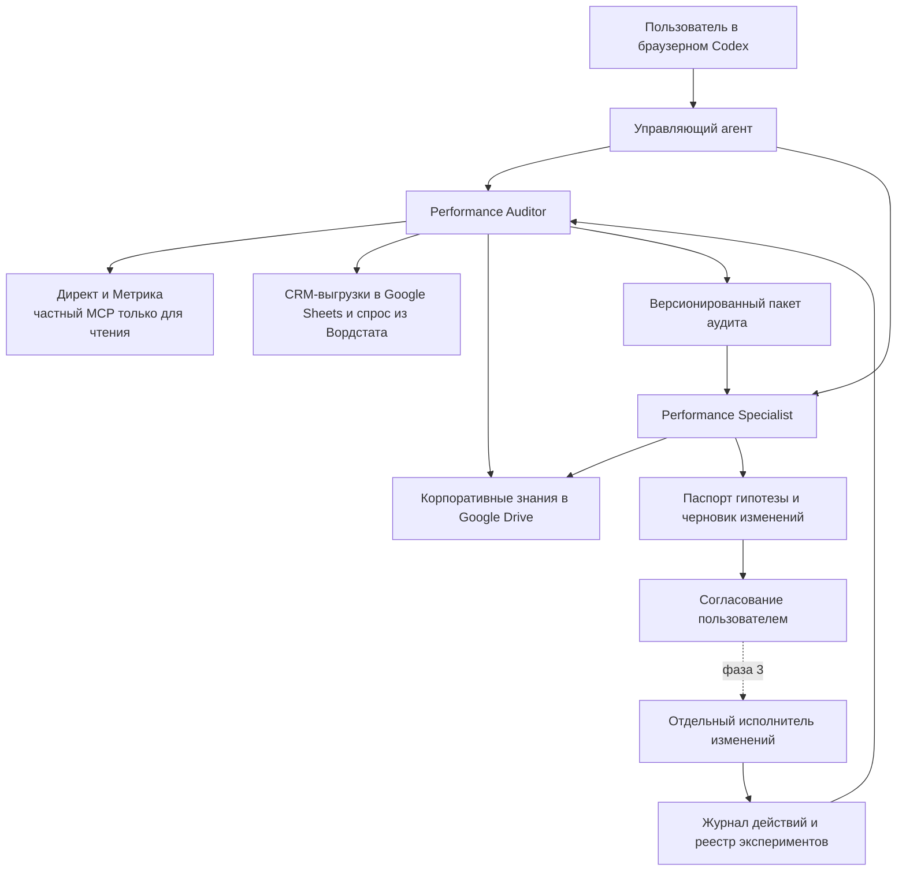

# Целевая архитектура AI Performance Manager

**Статус — согласовано пользователем 28 ноября 2026 года.** Реализованный технический базис
описан в [текущей архитектуре](../architecture.md). Порядок работ и критерии перехода
между фазами описаны в [дорожной карте](../guides/ai-performance-manager-roadmap.md).

## 1. Цель и границы

AI Performance Manager координирует performance-маркетинг нескольких B2B-продуктов.
Первый результат — проверяемый аудит одного продукта и одного кабинета с рекомендациями
по качеству лидогенерации. Полный цикл впоследствии включает подготовку рекламных
решений, согласование изменений и независимую оценку их эффекта.

| Компонент | Ответственность | Вход и выход |
| --- | --- | --- |
| Управляющий агент | Уточняет цель, продукт, разрешённую область, период и формат результата. Выбирает маршрут работы. Передаёт доказательства, ограничения и открытые вопросы между модулями. | Задача пользователя → контекст запуска и результаты модулей |
| Performance Auditor | Проверяет качество данных, анализирует расходы и воронку CRM, исследует спрос и аудитории, диагностирует рекламные связки, оценивает эксперименты. | Контекст и данные источников → пакет аудита, гипотезы, план, отчёты |
| Performance Specialist | Принимает бизнес-задание или пакет аудита. Начинает с улучшения имеющейся рекламы, проектирует связки, готовит черновики и план проверки. | Контекст и доказательства → паспорт гипотезы, комплект материалов, план изменений |
| Исполнитель изменений | В будущей фазе применяет только утверждённый перечень операций и записывает результат каждой. | Согласованный план → результат применения, журнал и сведения о восстановлении |

Самостоятельный запуск обоих специалистов использует тот же контракт входа.
Аудитор может начать с задачи без специалиста, специалист — с бизнес-задания без аудита.
При повторной оценке аудитор получает исходные данные, утверждённый план измерения
и факты исполнения в отдельном контексте. Обоснования автора изменений хранятся отдельно
от доказательств эффекта.

### Обязательные требования к профессиональной работе

1. Основной критерий результативности объявлений, креативов и посадочных страниц —
   количество подтверждённых реальных заявок, отнесённых к объекту или его версии
   по доказанной связи. Расходы, стоимость и качество заявок дополняют оценку.
   CTR и другие технические показатели служат диагностике.
2. Новое утверждённое исследование ЦА сначала применяется к действующим кампаниям.
   Агент фиксирует версию знания, проверяет сегмент, семантику, оффер, объявление,
   креатив и посадочную, приводит доказательства несоответствия и предлагает
   обоснованные изменения и способ измерения эффекта. При устаревших или
   противоречивых данных указывает ограничение.
3. Рекламные тексты, визуальные креативы и посадочные получают отдельную
   профессиональную оценку. Компетенцию можно вынести в Skill или отдельный
   модуль, сохранив контракты контекста, доказательств и результатов.

## 2. Схема и реализация в Codex

**Рекомендуемый старт — управляющий сценарий в браузерном Codex и отдельные задачи
для экспертных ролей.** Контекст передаётся пакетом с версией схемы, а авторизация
источников и разделение инструментов выполняются в подключениях и на стороне серверов.
Текущий read-only профиль вызывается через уже проверенные частный плагин и Secure MCP
Tunnel. В первом пилоте достаточно одного экземпляра, привязанного к одному кабинету
и счётчику. Для независимого запуска открывается задача нужной роли с разрешёнными
источниками и соответствующим входным пакетом.

Позже можно оценить библиотеку Skills и настроенных подагентов Codex как способ
координации. В ChatGPT Work подагенты используют инструменты родительской задачи,
а в Codex наследование контекста, инструментов и прав зависит от режима запуска.
Каждое новое подключение проверяется в том же браузерном режиме, в котором им будут
пользоваться. Подагенты и Skills служат для методики и маршрутизации. Коннекторы,
серверы и учётные записи задают границы доступа. Во время фазы записи управляющий чат
передаёт план через шлюз согласования и не получает прямых инструментов записи.
[Плагины в Codex](https://help.openai.com/en/articles/20001256-plugins-in-chatgpt#use-a-plugin) ·
[Права подагентов](https://learn.chatgpt.com/docs/agent-configuration/subagents#approvals-and-sandbox-controls) ·
[Secure MCP Tunnel](https://developers.openai.com/api/docs/guides/secure-mcp-tunnels)

Отдельный сервис оркестрации имеет смысл при подтверждённой потребности в расписаниях,
очередях, автоматическом возобновлении, машинной маршрутизации прав или журнале
исполнения. Пакеты обмена позволяют заменить задачи Codex самостоятельными агентами
по одному и добавить другие роли, например CRO-специалиста или медиапланера.

## 3. Что уже существует и что предстоит добавить

| Область | Сохраняем в текущем виде | Расширение после согласования |
| --- | --- | --- |
| Директ и Метрика | [Профиль MCP](../../phase1_readonly.py), восемь разрешённых операций, привязку к одному кабинету и счётчику, проверку области и HTTP-запроса | Серверно проверяемую маршрутизацию нескольких областей, дополнительные отчётные разрезы, согласованные поля целей и моделей атрибуции |
| Обработка отчётов | [Лимиты и проверку форматов](../../phase1_reports.py), ошибки при превышении и неполном ответе, общие обработчики существующего сервера | Планировщик выборок, нормализацию, манифест покрытия и расчёт показателей |
| Тестирование и подключение | [Синтетический сервер](../../phase1_demo.py), существующие тесты, CI, частный плагин и туннель | Обезличенные эталоны для CRM и профессиональной оценки, тесты прав каждого подключения |
| Остальные инструменты | Существующие модули Директа, Метрики, Аудиторий и Вордстата в основном сервере | Для исследования спроса проверить существующие обработчики Вордстата под самостоятельным ограниченным профилем |
| Профессиональная работа | Существующие служебные репозиторные Skills | Контракты обмена, методики, профессиональные Skills, CRM/Drive, реестр гипотез, черновики и будущий исполнитель |

Базовый профиль имеет дедлайн 90 секунд и пределы 31 календарный день, 1 000
строк и 128 КиБ на отчёт. Функция формирования запроса Direct Reports сейчас
не передаёт `Goals` и `AttributionModels`. Поддержку разрезов следует проверять
по типам отчётов и совместимым полям Яндекса. Источники интегрируются вне базового MCP,
когда их доступы и жизненный цикл отличаются.
[Код запроса Direct Reports](../../server.py#L1690-L1712) ·
[Спецификация отчётов Директа](https://yandex.ru/dev/direct/doc/ru/spec)

## 4. Источники данных и частная база знаний

| Источник | Назначение и предлагаемый интерфейс |
| --- | --- |
| Директ | `AdvertisingReader` получает расходы, структуру и показатели по разрешённой области, с версией запроса и признаком полноты. |
| Метрика | `AnalyticsReader` получает цели, данные счётчика и агрегированные отчёты. Сохраняет определения целей, модель атрибуции, семплирование и ограничения. |
| Google Sheets | `CrmLeadReader` читает утверждённый лист или именованный диапазон выгрузки Битрикс24. Проверяет схему и свежесть, нормализует статусы по версии справочника. Лист обновляется вручную. Аналитическое обогащение хранится отдельно. Прямое подключение к Битрикс24 не планируется. |
| Вордстат | `DemandReader` получает динамику запросов по региону и периоду, фиксирует параметры и дату выгрузки. Спрос используется как один из факторов диагностики. |
| Google Drive | `KnowledgeReader` находит документы в разрешённой области, отбирает утверждённые действующие версии и возвращает ссылки с точными местами и датой. |
| WordPress и генерация изображений | Фаза 2. Требуют отдельного исследования шаблонов и прав. Креативы проходят проверку брендбука, лицензий, форматов и согласованности с оффером. |

Имена интерфейсов показывают границы будущих адаптеров. На пилоте данные передаются
в стабильном формате. Отдельные сервисы для каждого адаптера заранее не нужны.

**База знаний.** Google Drive остаётся источником, который владелец обновляет без
кода. Предлагается утверждённый каталог в Google Sheets с полями `document_id`,
категория, продукт и сегмент, владелец, версия, даты действия, статус,
ссылка и `supersedes`. Категории охватывают продукт, рынки и аудитории, бренд и
редакционные правила, KPI и планы, справочники CRM, реестр аккаунтов, шаблоны,
методологии, историю гипотез и эксперименты. Тип сведений хранится отдельно от
статуса документа — факт, исследование, подтверждённый результат или предположение.
Использовать актуальное утверждённое знание. Конфликт двух действующих источников
передаётся владельцу вместе со ссылками и влиянием на вывод. Для воспроизводимости
сохраняются версия источника и разрешённый снимок или хеш фрагмента в частном
хранилище, если провайдер не позволяет прочитать прежнюю версию.

**Доступ.** Для пилота проверить нативный Google Drive в целевой задаче. Границы
доступа задавать на стороне Google и, при необходимости, через адаптер с разрешёнными
идентификаторами файлов и диапазонов. Настройки ChatGPT для Drive не дают точечных
исключений по папкам и отдельным файлам. Рабочий вариант при отсутствии нужной
изоляции — отдельная учётная запись с правом просмотра специально подготовленной
выгрузки и ограниченного диска. Скрытые столбцы Google Sheets не считаются защитой.
Модель получает только согласованные поля и обычно агрегаты. Сопоставление CRM
выполняется в доверенной среде по утверждённым идентификаторам или
псевдонимизированным ключам. Секреты хранятся вне Git, а рабочие наборы, отчёты
и внутренние KPI — в закрытых хранилищах с ограничением доступа и срока хранения.
[Google Drive в ChatGPT](https://help.openai.com/en/articles/10929079-google-drive-app-and-setup-in-chatgpt) ·
[Границы управления доступом Drive](https://help.openai.com/en/articles/20001608-managing-google-drive-access-in-chatgpt)

## 5. Получение и проверка полноты данных

1. **Разрешить область.** Реестр связывает кабинет, счётчик, подрядчика, продукт
   и интервал действия связи. Допускаются несколько продуктов на аккаунт и несколько
   продуктов, по которым поступили заявки из одной кампании. Хранить отдельно
   приоритетный продукт кампании и фактический продукт заявки. По названию и странице
   формировать только кандидата на соответствие. Неоднозначность подтверждает владелец.
2. **Спланировать запросы.** Зафиксировать разрез, фильтры, валюту, НДС, модель
   атрибуции, часовой пояс, период событий и контрольный срез. Разделить период
   на непересекающиеся интервалы в часовом поясе источника. При переполнении
   делить по времени или по взаимоисключающим значениям стабильного ключа,
   если это разрешает API. Для неизменённого профиля применять короткие окна
   и доступные фильтры. Любое расширение выборок и схемы проходит контрактные тесты.
3. **Проверить покрытие.** Манифест выборки хранит запланированные и выполненные
   части, параметры, строки, состояние источника и ошибки. Повторы идемпотентны
   по ключу запроса, схема и гранулярность проверяются. Если минимальный допустимый
   разрез не помещается, пометить набор как неполный. Сверять аддитивные итоги
   с общим контрольным запросом там, где это возможно. Ограничить число запросов
   и параллельность отдельно для каждого API и авторизованного аккаунта.
4. **Собрать показатели.** Денежные суммы и количества складываются только для
   сравнимых непересекающихся совокупностей. CTR, CPC, CPA и конверсии воронки
   вычисляются из общих числителя и знаменателя, при нулевом знаменателе значение
   отсутствует. Уникальных пользователей, охват, медианы и иные неаддитивные
   величины запрашивать на общей гранулярности, либо показывать по интервалам
   без общего итога. Смешанные валюты, НДС или модели атрибуции публиковать
   отдельно до согласования нормализации.
5. **Учесть CRM во времени.** Повторные строки одной выгрузки устраняются по
   устойчивому ключу записи и версии. Бизнес-кластер «дубли» остаётся частью
   отчёта. Отдельно хранить дату обращения, дату изменения статуса и срез выгрузки.
   Окна дозревания, доли сопоставленных и неизвестных записей показывать явно.
   На уровне объявления, креатива и посадочной приписывать бизнес-результат
   только при проверенной связи. Для остальных показывать доступные агрегаты
   и уровень достоверности.

## 6. Работа аудитора и специалиста

**Auditor.** Сначала проверяет качество данных и проводит F-01. Сопоставляет
счётчики, цели, форму, регистрацию заявки и выгрузку CRM. Страница входа и
страница отправки формы хранятся отдельно. Общие подсчёты и сопоставимые
типы событий сравниваются независимо. Учитываются квизы, подписки, тестовые и
повторные обращения. Расхождение фиксируется как наблюдение. Для подтверждения
неисправности требуется доказательство её механизма. Итог F-01 — «корректно»,
«подтверждённая неисправность» или «не удалось проверить», с доказательствами,
ограничениями и затронутыми данными. Контрольная отправка формы выполняется вручную
или отдельно согласуется. Критичность и остановку аудита определяет пользователь.

Далее аудитор оценивает качество лидогенерации: число и долю квалифицированных,
число и долю мусорных, стоимость квалифицированных и объём и стоимость валовых.
Возможный рост CPL оценивается вместе с бизнес-результатом. Восемь категорий
берутся из справочника. Неизвестные и архивные стадии выделяются отдельно.
[Утверждённые правила метрик](../specs/2026-11-28-auditor-data-contract.md#7-утверждённая-методология-и-справочник-метрик)
Промежуточные цели и цели оптимизации учитываются отдельно от бизнес-конверсий.
При анализе учитываются сезонность, спрос, задержки квалификации, малые выборки
и альтернативные объяснения. CTR, CPC и прочие технические показатели служат
диагностике. По дорогой, но качественной заявке решение зависит от всей воронки.

Планируемая глубина аудита охватывает подрядчиков, продукты и кабинеты, кампании,
группы, стратегии и цели, семантику, запросы и минус-фразы, объявления, офферы,
креативы, посадочные, РСЯ, географию, устройства, демографию, сегменты и таргетинги,
расписание, бюджеты и динамику. Проверяется цепочка от потребности аудитории
до продажи. Вордстат и исследования ЦА дают основания для гипотез, а причинность
требует независимых доказательств. При низкой надёжности аудитор предлагает
проверки и оставляет решения об отключении и масштабировании открытыми.

**Specialist.** Сначала оптимизирует существующие связки и обосновывает каждое
изменение. Развитие, масштабирование и новые кампании рассматриваются по результатам
диагностики. Проектирует согласованную связку от потребности и семантики до оффера,
креатива, посадочной и целевого действия. Для WordPress сначала изучаются шаблоны
и конфигурация сайта. Пилот фазы 2 проверяет на отдельной среде черновики на 1–3
экрана, мобильную версию, формы, аналитику, историю ревизий и альтернативный вариант
для теста. Права автора черновика разделяются с правами публикации. API и способ
генерации креативов выбираются после оценки действующего стека и требований.
[WordPress Pages](https://developer.wordpress.org/rest-api/reference/pages/) ·
[Ревизии страниц](https://developer.wordpress.org/rest-api/reference/page-revisions/)

### Самостоятельные критерии качества материалов

| Артефакт | Что проверяет эксперт |
| --- | --- |
| Рекламный текст | Соответствие запросу и сегменту, ясность оффера и CTA, точность обещаний, язык бренда и правила площадки, связь с посадочной |
| Визуальный креатив | Читаемость в нужном формате, единое сообщение с текстом, заметность и композиция, бренд, право использования и правила площадки |
| Посадочная страница | Соответствие обещанию, ясность первого экрана и CTA, мобильная версия, форма и признаки регистрации заявки, пригодность аналитики для F‑01 |

По каждому артефакту фиксируются версия, результат по критериям, доказательства,
причина доработки и условия повторной проверки. Эти оценки дополняют измерение
реальных заявок. Общий паспорт гипотезы сохраняет связь результатов при выделении
компетенций в самостоятельные Skills или модули.

## 7. Контракты и разграничение прав

Контракты предлагаются как версионированные JSON-схемы с проверками при передаче.
Пакеты содержат ссылки и необходимые минимальные сведения. Они сохраняются
в частном хранилище, а в публичном репозитории доступны только схемы и синтетика.

| Пакет | Ключевые поля |
| --- | --- |
| `RunContext` | `schema_version`, ID запуска, инициатор, цель, ссылки на область доступа, продукт и период, нужный формат, версии словарей |
| `DataManifest` | Источник, срез и период, стабильный запрос, дата загрузки, версия или снимок, параметры атрибуции, число строк, статус покрытия, предупреждения, защищённая ссылка |
| `AuditPackage` | Контекст и манифесты, F-01, метрики и доказательства, альтернативные объяснения, пробелы, гипотезы, рекомендации с приоритетом и критериями проверки |
| `HypothesisSpec` | ID и версия, продукт, сегмент, исследования, проблема и стадия решения, ценность, оффер, семантика, сообщения, концепция креатива, посадочная, CTA, стратегия, бюджет, KPI, условия успеха, ссылки на версии материалов |
| `ChangePlan` | ID и версия, точные объекты и операции, до/после, ожидаемый эффект, предпосылки, лимиты, условия согласования, исходное состояние и доступный способ восстановления |
| `ExperimentRecord` | Ссылки на гипотезу, версии связки и данные, основной показатель, база сравнения, группы и сроки, бюджет, фактические результаты, зрелость, ограничения и решение |

Управленческий отчёт включает резюме, покрытие, расходы и воронку, разрезы,
обоснование и приоритетный план. Отчёт подрядчику строится из разрешённой области
с отдельной проверкой состава и источников. Передача наружу требует согласования.
Приоритет предложений учитывает эффект, надёжность, срочность, трудоёмкость и риск.
Пороговые значения для ранжирования утверждаются отдельно.

| Роль | Чтение | Разрешённый результат работы |
| --- | --- | --- |
| Управляющий агент | Область задачи и сокращённые результаты модулей | Маршрутизация и передача пакетов |
| Auditor | Ограниченные рекламные источники, подготовленные CRM и знания | Отчёт, манифест, гипотеза и оценка |
| Specialist | Данные разрешённой области, аудит и утверждённые знания | Паспорт гипотезы, черновики в выделенной области и план изменений |
| Исполнитель | Утверждённый план и состояние затрагиваемых объектов | Операции в пределах указанной версии плана, журнал и результат |

Входные ссылки на области проверяет сервер или оператор подключения, а не модель.
Сначала — отдельный процесс и токен на утверждённую пару кабинет–счётчик.
После пилота — закрытый реестр и маршрутизация по аутентифицированному субъекту
и серверному списку разрешённых пар. При отсутствии надёжного механизма авторизации
сохранять независимые подключения. Данные внешних документов и сайтов трактуются
как недоверенный ввод. Извлечённый текст не меняет разрешения, источники и правила
передачи данных. Пользователь не может переключить область переданным аргументом.

Аудитор имеет только чтение и право готовить свои отчёты в утверждённом хранилище.
Специалист имеет чтение и в фазе 2 создаёт черновики в выделенной области.
Для фазы 3 нужен отдельный исполнитель с узкими токенами и белым списком операций.
Согласование связывается с хешем версии плана, областью, сроком и участником.
Перед исполнением — проверка актуальности, исходного состояния и лимитов.
Исполнение идемпотентно, частичный успех фиксируется по объектам,
восстановление тестируется для обратимых операций. Потраченный бюджет и состоявшийся
показ нельзя откатить. В журнал попадают ID действия, результат, оператор,
время, доказательство согласования и ссылки на исходное состояние, без секретов.

Реестр экспериментов фиксирует гипотезу, baseline, критерии, контрольную и тестовую
версии, период дозревания и пересекающиеся изменения. При возможности используется
контрольная группа и заранее согласованный метод оценки. Случайное колебание
или сравнение несопоставимых периодов не подтверждает причинность.

## 8. Будущая структура Skills

| Группа | Предлагаемые Skills и материалы |
| --- | --- |
| Общие | `performance-context` — стратегия, бизнес-контекст, поиск знаний и исследования ЦА. `performance-data-quality` — трекинг, F-01, качество CRM, правила расчётов. `experiment-review` — план, критерии успеха, оценка и контроль качества. |
| Auditor | `performance-audit` — спрос, кампании и стратегии, связка и воронка, подрядчики. `audit-reporting` — управленческий и подрядный форматы, доказательства и приоритеты. |
| Specialist | `campaign-design` — оптимизация, семантика, офферы и тексты. `creative-and-landing` — визуалы, посадочные и WordPress. `campaign-draft` — структура кампании, бюджет, стратегия, согласование и подготовка плана. |
| Исполнение | `approved-campaign-changes` — только при запуске фазы 3, вместе с внешним контуром согласования и отдельной ролью. |

В каждом будущем `SKILL.md` указываются условия применения, данные, алгоритм,
ограничения, формат и контроль качества. F-01, матрицы разрезов, формулы,
шаблоны отчёта и паспорта гипотезы хранятся рядом как справочные материалы.
Сотрудники обновляют корпоративные факты в Drive. Подключение Skills в конкретном
браузерном режиме проверяется при внедрении. [Руководство OpenAI по Skills](https://learn.chatgpt.com/docs/build-skills)

[Контракт первого аудита](../specs/2026-11-28-auditor-data-contract.md) · [Синтетический сценарий](../guides/auditor-control-scenario.md)
